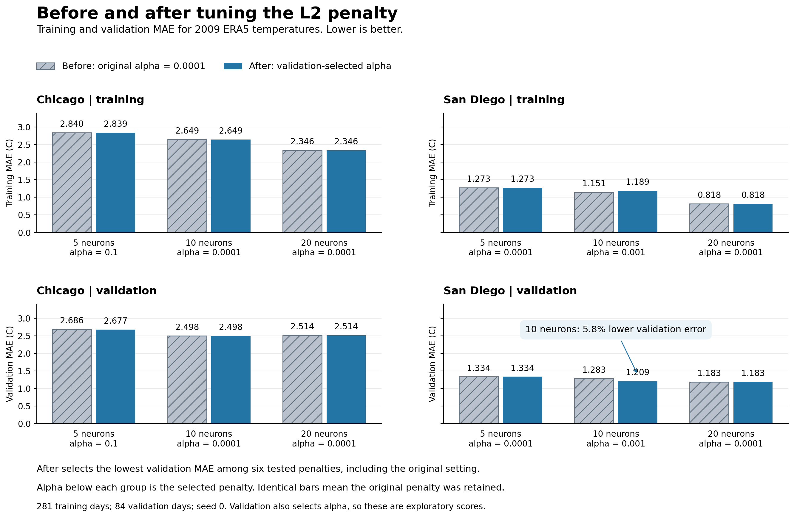

# Before and after tuning L2 regularization

**L2 tuning improved San Diego's 10-neuron model, but it did not lower either city's best overall validation MAE.**

## What changed?

The original models already used weak L2 regularization, alpha 0.0001. We compared that setting with the lowest-validation-MAE penalty from the fixed grid 0.0001, 0.001, 0.01, 0.1, 1, and 10, separately for each city and network size. Every other model setting stayed fixed, including seed 0. All models used the same 281 training days and 84 validation days in 2009, with the final seven days of each month held out. MAE is average absolute error in Celsius; lower is better.

| City | Neurons | Selected alpha | Training MAE: before to after | Validation MAE: before to after |
|---|---:|---:|---:|---:|
| Chicago | 5 | 0.1 | 2.840 to 2.839 | 2.686 to 2.677 |
| Chicago | 10 | 0.0001 | 2.649 to 2.649 | 2.498 to 2.498 |
| Chicago | 20 | 0.0001 | 2.346 to 2.346 | 2.514 to 2.514 |
| San Diego | 5 | 0.0001 | 1.273 to 1.273 | 1.334 to 1.334 |
| San Diego | 10 | 0.001 | 1.151 to 1.189 | 1.283 to 1.209 |
| San Diego | 20 | 0.0001 | 0.818 to 0.818 | 1.183 to 1.183 |

The paired bars start at zero and share the same scale. Identical pairs are intentional: four of the six models kept their original penalty. The selected alpha is printed under each pair.

## Was it effective?

- **San Diego, 10 neurons:** Increasing alpha from 0.0001 to 0.001 reduced validation MAE from 1.283 to 1.209 C, a 5.8% improvement. Training MAE rose from 1.151 to 1.189 C. The model fitted training data slightly less closely while predicting the held-out weeks better. Validation RMSE also improved, from 1.553 to 1.460 C, and R2 rose from 0.788 to 0.812.
- **Chicago, 5 neurons:** Increasing alpha to 0.1 reduced validation MAE by only 0.009 C, about 0.3%. This run does not establish a meaningful practical benefit.
- **Other models:** The original alpha remained the best tested value. Chicago's 10-neuron model still has the lowest overall validation MAE at 2.498 C, and San Diego's original 20-neuron model still has the lowest at 1.183 C.

Regularization helped a particular smaller model, but stronger regularization was not consistently better. Keeping the original setting eligible also means that selected validation MAE cannot worsen by construction. This is a model-selection result, not independent confirmation that performance improved.

## Limitations

1. The same validation weeks choose the penalty and measure its reported performance. A separate, untouched evaluation is needed to confirm any gain; this validation set has already supported several exploratory comparisons.
2. This regularization comparison uses one random seed and one year. Differences may change with initialization, years, or held-out dates. The bars are individual-run scores, not averages or confidence intervals.
3. Training includes dates after most validation dates, and adjacent days can have related weather. This evaluates reconstruction of withheld temperatures within 2009; future forecasting accuracy remains untested.
4. Day of year is the only input. L2 adds no information about recent weather, pressure, or wind and cannot solve that missing-information problem.

## Short presentation script

> This graph compares the original weak L2 penalty with a validation-selected penalty for each network size. The clearest change is San Diego's 10-neuron network: validation error fell from about 1.28 to 1.21 degrees Celsius, while training error increased slightly. That means a closer training fit was not necessary for better validation predictions. Chicago showed only a tiny improvement, and four models kept their original penalty. The original best models still had the lowest validation MAE overall. These findings are limited to one year and one seed, and we used validation data to select the penalty, so an independent evaluation is needed before claiming a general improvement.

## Files and verification

Source tables: [comparison.csv](comparison.csv) and [all_scores.csv](all_scores.csv). The plotted MAEs were checked against [saved daily predictions](predictions.csv), including the exact monthly split. The original alpha settings and selected minima were verified. The graph uses existing saved results; no model settings were changed or models refitted. This chart-generation step does not verify execution in the active Jupyter kernel.

Downloads: [PNG](before_after_l2.png), [PDF](before_after_l2.pdf), [SVG](before_after_l2.svg), and [plotted data](before_after_l2_table.csv).
